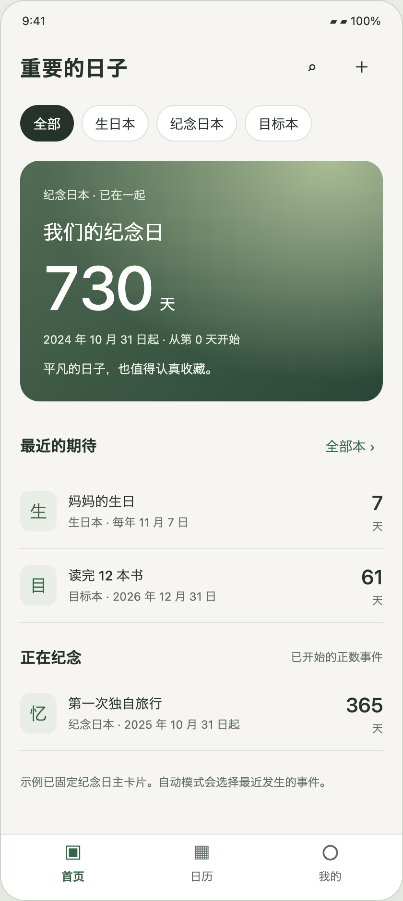
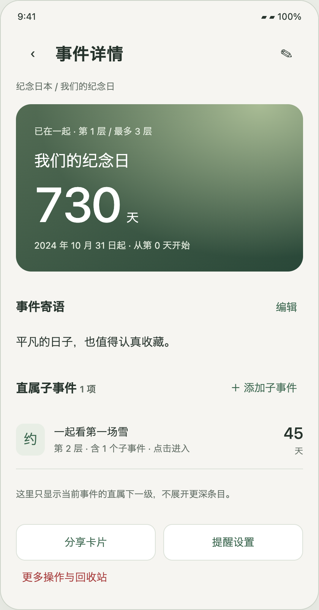
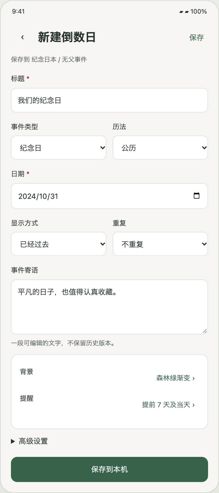
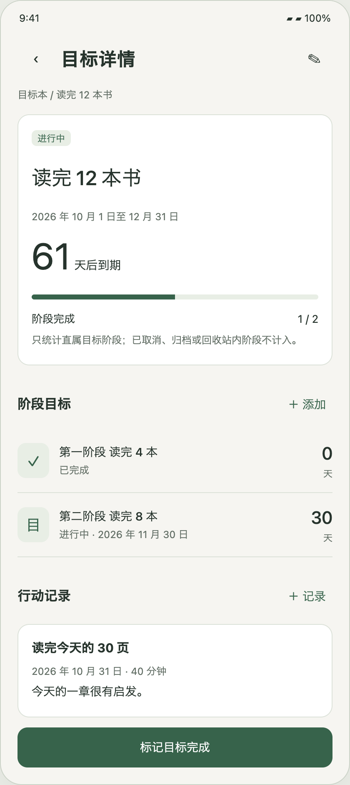
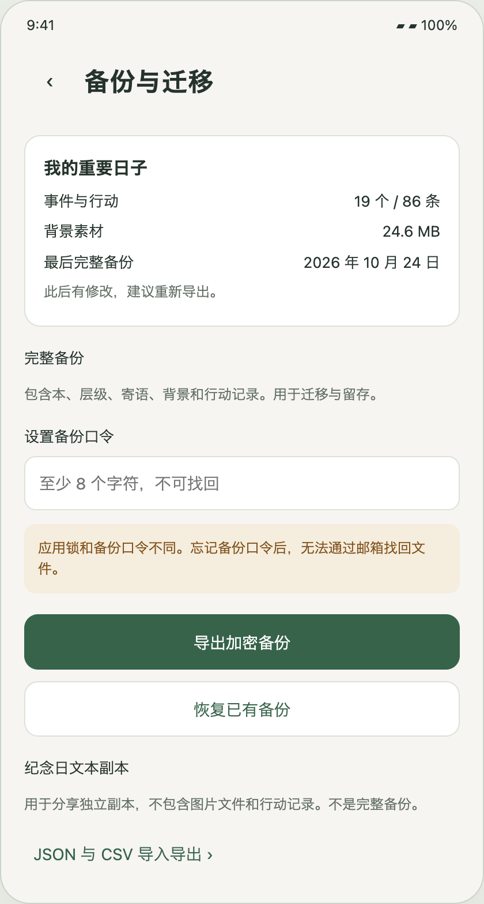
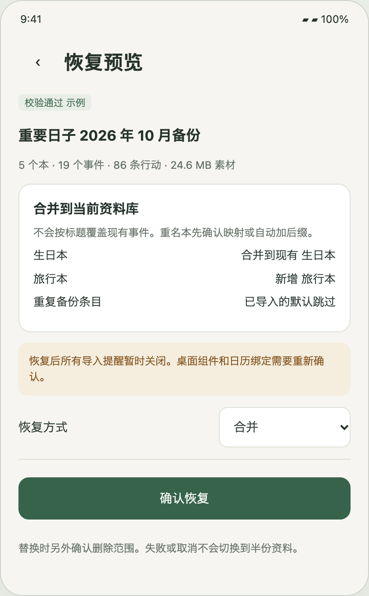
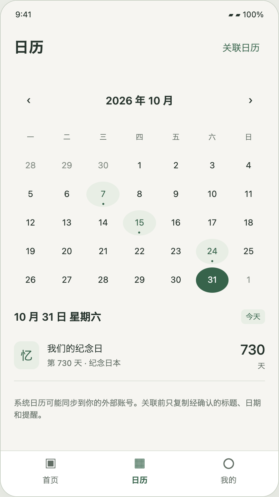
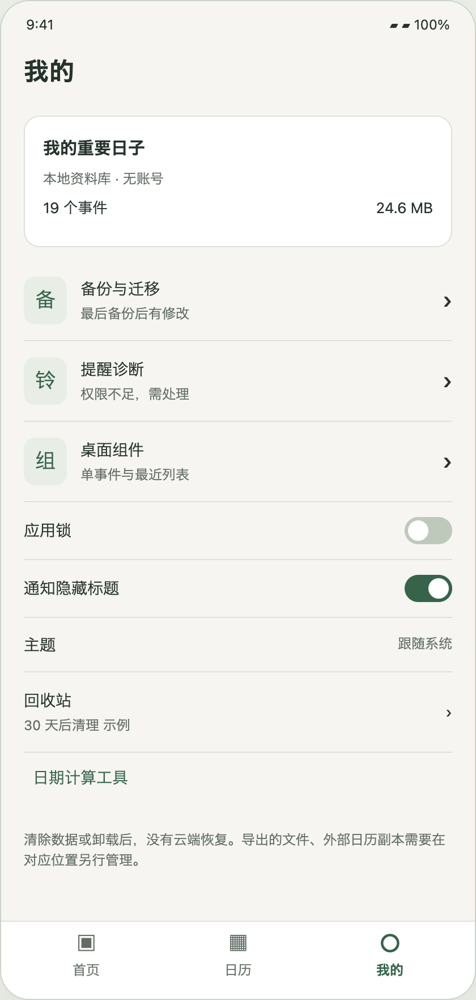
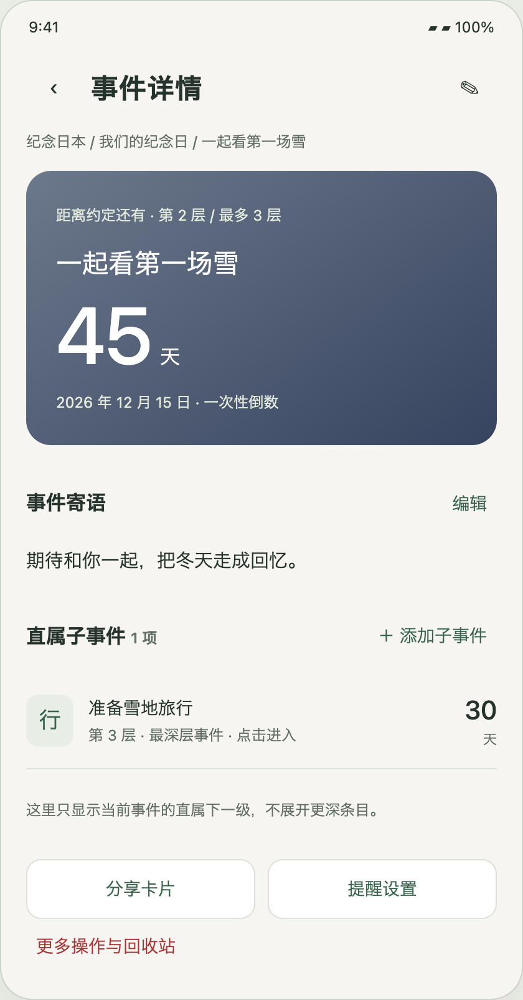
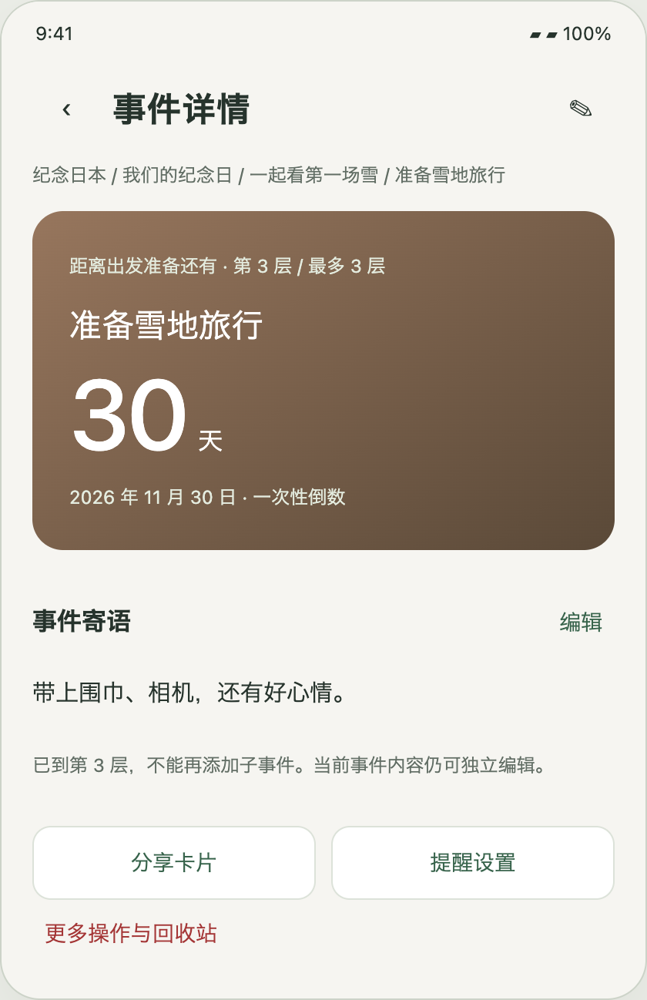

# Android 技术设计 TD v1.1

这是 [原始 Word 文档](../source/TD_v1.1.docx) 的 GitHub 阅读版，保留原有正文、表格与图片；原文档不修改。

本文件记录原设计，不代表运行验收结果。当前实现选型及偏差见 [架构决策](../decisions/ADR.md)、[实现状态](../development/IMPLEMENTATION_STATUS.md) 和 [测试报告](../testing/TEST_REPORT.md)。最新确认：仅 Android、无账号和云库、最多三级、详情只展示直属下一级。

---

## 倒数日 Android 技术设计

开发用例  系统架构  数据模型  页面与验证

版本 1.1  2026 年 10 月 31 日

## 1  设计结论与使用边界

仅开发 Android，使用 Android Studio、Kotlin、Jetpack Compose 和 Room。业务数据、背景与设置只存本机，不做账号、登录注册或云数据库。首页、详情、提醒、组件和卡片共用日期核心与业务规则。

v1.1 纳入开发 PIC 评审修订和最新页面要求：详情只列当前事件的直属下一级，点击子条目进入其详情；三级不再新增子事件。首版不做树形内联展开或下拉展开孙级。每个节点仍有独立的日期、背景、寄语与提醒。

| 交付与基线 | 作用 |
| --- | --- |
| 产品约束 | PRD 与详细需求规格 v1.1；本轮确认覆盖旧稿中与详情展示相冲突的描述 |
| TD v1.1 | 用例、架构、页面、方法、数据、异常、测试和开工门禁 |
| 交互原型 v1.1 | 新增一级、二级、三级独立详情及返回链；不执行真实保存或权限 |
| SQL 设计 v1.1 | 修复延迟外键绕过、文本安全上界、空值唯一与来源去重；不是 Room 构建产物 |
| 文件契约 v1 | 06_android_file_contracts_v1.schema.json；文本、备份快照、清单与容器头模型 |

本 TD 是开发设计基线，不是 App 实现或验收报告。用户确认项、PIC 默认实现项、M0 必验项及发布前产品决定分开记录，不能把设计闭环称为 Android 构建或真机验证已通过。

文档沿用原有章节顺序以便对照，新增附录集中记录层级交互、文件协议、工程落地和评审关闭条件。v1.0 及产品文档保留不覆盖；发生歧义时以本轮用户确认、再以 v1.1 修订规则为准。

## 2  需求范围与模块对应

| 需求组 | 实现责任 | 范围 |
| --- | --- | --- |
| LOC SEC | 首次启动、本地资料库、应用锁、隐私设置与手动迁移 | P0 |
| BOOK TREE | 本与标签、最多三层事件、移动、归档、回收站 | 核心 P0 批量标签 P1 |
| EVT MSG MEDIA | 完整事件字段、单段寄语、独立背景、复制与编辑 | P0 |
| DATE REC HOME | 统一公农历、正倒数、重复、首页排序与固定 | P0 |
| NOT | 本地提醒、权限降级、诊断与重建 | P0 |
| GOAL ACT | 阶段目标、状态、进度与行动记录 | P0 |
| TXT CARD BKP | JSON 与 CSV、静态卡片、加密完整备份及恢复 | P0 |
| WID | 单事件与最近列表桌面组件；支持设备的锁屏适配 | 桌面 P0 锁屏 P1 |
| CAL TOOL | 月历、系统日历单向添加和选择导入、日期工具 | P1 |
| DATA NFR | 关系约束、迁移、异常恢复、性能与无障碍 | 贯穿版本 |

P0 和 P1 都属于产品目标版本，允许分里程碑交付，不允许把缺少 P1 的核心演示包宣称为完整交付。系统日历“托管持续关联”是额外选项，是否纳入需 D06 审批；文档保留其接口边界，不默认开发自动双向同步。

明确排除 iOS、在线共享、账号与邮箱验证、云端备份服务、服务器推送、在线图库、多条小纸条、自动生成百日千日节点。用户主动导出给其他人后得到独立副本，不形成共享资料源。

容量建议维持产品规格的 200 个本、2000 个有效事件、10000 条行动记录。归档不用于绕开安全容量；导入预览同时显示活跃、归档及回收站总量。媒体超过 100 MB 是性能参考集之外的情况，不静默丢弃数据。最终硬上限见 D10。

## 3  用例目录与验收责任

| 用例 | 用户意图与结果 | 需求 |
| --- | --- | --- |
| UC01 | 首次进入直接创建或导入，不出现身份输入 | LOC SEC |
| UC02 | 创建生日并逐年显示下一生日和默认提醒 | EVT DATE REC NOT |
| UC03 | 管理本，按下一日期查看与手动固定事件 | BOOK HOME |
| UC04 | 创建至第三层子事件，校验移动和独立字段 | TREE MSG MEDIA |
| UC05 | 制定目标、完成阶段、写行动与查看进度 | GOAL ACT |
| UC06 | 归档、删除、恢复及到期永久清理子树 | TREE SEC DATA |
| UC07 | 导出文本独立副本并预览导入 | TXT |
| UC08 | 生成静态卡片，选择是否包含寄语 | CARD MEDIA |
| UC09 | 导出完整加密备份，在本机或新机恢复 | BKP SEC DATA |
| UC10 | 添加桌面组件并设置组件隐私 | WID HOME |
| UC11 | 查看月历、添加到系统日历或选择导入 | CAL |
| UC12 | 发现提醒权限不足并检查重建结果 | NOT |
| UC13 | 搜索、标签与批量操作，不重复处理子树 | HOME BOOK |
| UC14 | 本地应用锁解锁、无备份时理解不可恢复 | SEC |
| UC15 | 计算日期差、日期推算与周一至周五天数 | TOOL |

所有用例的共同前置条件是当前资料库可读且应用锁已解开。权限拒绝只能阻止对应系统集成，不能阻止本地保存。关键写操作返回持久化结果与副作用状态两个维度，不能用“保存失败”掩盖实际已经保存的资料。

## 4  生日和三层事件用例

### UC02 生日循环

用户选择生日本，填写标题、公历或农历月日，可选出生年份。保存时生日强制全天，默认每年重复、提前 7 天及当天 09 点提醒。先提交事件和规则，再解释并请求通知权限。权限不足时详情显示“已保存 提醒待开启”。

公历生日 11 月 7 日：2026 年 10 月 31 日为 7 天后；11 月 7 日为“今天生日”；11 月 8 日为“距离下次生日 364 天”。无出生年份不展示年龄，不用当前年份伪造出生年。提前提醒已过时不补发。

异常分支：农历不支持日期返回 DATE_OUT_OF_RANGE；用户取消授权仍保留事件；媒体复制失败保留旧背景；重复点击保存使用 operationId 幂等，只创建一次。

### UC04 手动添加与移动子树

从详情新增时预填 bookId、parentId，表单顶部显示保存路径。父事件是第 1 层，可新增第 2 层；第 2 层可新增第 3 层；第 3 层不显示新增下级，方法层和数据库触发器仍拒绝第 4 层。

保存子事件时字段默认独立，不继承寄语或照片文件引用，除非用户明确使用复制。建议只继承所属本和上下文父事件，日期默认今天；编辑父日期、重复或状态不更改子事件。

移动预览目标本、父节点和受影响数量。事务内重新读取树，校验目标不在被移动子树内、祖先数加子树高度不超过 3。跨本移动更新全部后代 bookId；保留事件 UUID、寄语、背景与记录。

并发保护：保存草稿带 expectedVersion，版本不一致返回 EVENT_CONFLICT，用户选择重新载入或保存为副本。归档或回收站内事件不允许直接新增或移动，先恢复，以免层级与状态含义不清。

## 5  目标 分享与恢复用例

### UC05 目标与行动

创建目标时选开始日和计划完成日，截止日期只存于事件日期，目标明细不再重复保存。阶段是用户手动建立的子目标；普通子事件仍可存在但不计阶段进度。行动记录包含日期、1 至 1000 个可见字符、可选 0 至 1440 分钟，不能记录未来日期。

标记完成只作用于当前目标，记录 completedAt，取消本目标提醒，不更改后代。重新打开清除完成时间，保留行动与计划日期，只安排尚未过去的提醒。存在行动或阶段时，不允许直接把目标改成普通事件，需明确清理或另存副本。

### UC07 与 UC08 独立分享

导出文本先选事件、子树或本，默认不包含寄语，背景仅导出内置样式和裁剪描述，不携带私有路径或图片。导入预览有效条目、重名本和跳过项；确认后再提交。卡片只导出当前事件，不自动包含路径、子节点、行动或私人提醒。

### UC09 完整恢复

用户通过系统文件选择器选文件，输入备份口令。应用验证容器、解密、校验清单与完整模型后展示预览。默认合并；替换须明确展示当前资料将被替换，并再次确认。恢复前不改变当前数据库、文件、提醒或组件。

确认后建立独立候选资料库目录，完成迁移、关系与文件校验，再原子切换当前目录指针。恢复完成后导入规则一律暂停，日历绑定不复制；现有桌面组件显示“请重新选择事件”。旧任务即使触发，也因资料库代次不符而不发送通知。

失败分支：口令错误或损坏不输出半份结果；空间不足不清旧数据；切换前取消保留原库；切换后进程退出，下次启动继续清理旧任务和刷新组件，不回滚已提交的新库。

## 6  架构选型与版本策略

| 项目 | 开发基线 | 落地要求 |
| --- | --- | --- |
| 开发环境 | Android Studio 稳定通道 | IDE 不是架构框架；使用项目 Wrapper 与明确 JDK，不能只依赖本机环境 |
| 应用结构 | 原生 Kotlin、单 Activity、Compose Material 3 | MVVM 单向数据流；StateFlow；类型安全 Navigation Compose |
| 本地数据 | Room 2.8.5、SQLite、私有不可变媒体 | Room 2 系列；KSP 生成代码；不混用其他主版本示例或 API |
| 业务计算 | 纯 Kotlin Domain 与 datecore | java.time；离线农历版本包；依赖 Clock 与 ZoneProvider |
| 系统适配 | AlarmManager、WorkManager、Glance | 系统提醒、延迟维护和组件分工；不提供后台常驻服务 |
| 辅助依赖 | DataStore、Hilt、Coroutines、Flow | 少量模块；无 HTTP、网络 SDK 或远端配置 |
| SDK | minSdk 26；compileSdk / targetSdk 37 | 作为 PIC 默认方案；设备覆盖与分发政策在 M0 复核 |

候选构建组合：AGP 9.2.1、Gradle 9.4.1、JDK 17；AGP 内建 Kotlin 路径以 2.2.10 为候选，Compose compiler 插件保持同版。此为待 M0 构建核验的组合，不是已经通过的兼容结论。AGP 9 不重复应用 org.jetbrains.kotlin.android。官方来源 S21 至 S23。

KSP、Compose BOM、Navigation、Hilt、Glance、WorkManager 与 DataStore 的具体版本必须在 M0 的 version catalog 一次锁定，并提交依赖校验文件、Wrapper 校验和及构建记录。不得用 latest、动态版本或把“待冻结”带进 M1；必要调整候选组合需 ADR 记录原因。

M0 验证从空工程扩展到 Room Entity 与触发器、Hilt/KSP、Compose 导航、Glance 各一个最小路径。Android Studio 能打开项目不等于上述依赖可编译；命令行与 IDE 应得到同一构建结果。

## 7  系统结构与模块依赖

Compose 页面  →  ViewModel  →  UseCase
                         ↓
                  Domain Ports
                  ↙          ↘
       Room Repository       System Adapters
       DB 与媒体索引          提醒  日历  分享  组件
                  ↘          ↙
              统一日期引擎与只读展示模型

| 模块 | 职责 | 允许依赖 |
| --- | --- | --- |
| :app | 启动、DI、导航、主题、feature 包 | domain data platform |
| :domain | 实体、用例、端口、树和目标规则 | datecore Kotlin 标准库 |
| :datecore | 日期差、重复、排序键、日历窗口 | java.time 与 LunarConverter 端口 |
| :data | Room DAO、Repository、文件与导入 | domain datecore |
| :platform | AlarmManager、通知、Glance、日历、SAF、锁 | domain datecore Android SDK |

禁止页面直接读 DAO、组件自行计算生日、通知 receiver 从 Intent 信任标题，或数据库事务内启动系统 Activity。UI 状态包含 Loading、Content、Empty、Error、Saving 与系统副作用告警。可恢复错误保留当前内容与草稿。

结构化业务写入是单一事实来源。一次用例在 Room 事务内写业务、递增 contentRevision、写 effectOutbox；提交后消费者重建提醒和组件快照。系统副作用失败不会撤销用户已保存的事件，但持续显示可重试状态。按 epoch 与 targetRevision 合并重复任务。

媒体写入采用私有暂存文件、解码校验、原子重命名后再关联数据库。未被提交引用的文件在延迟 GC 中删除。Repository 串行化资料库切换，后台任务在切换后重新获取当前 DB，不长期持有旧连接。

## 8  状态模型与目标计算

### 互不混淆的状态轴

事件类型、日期状态、生命周期和目标业务状态是四个不同维度。生命周期由多个归档或回收站操作原因计算，优先级为回收站高于归档高于正常。目标状态为未开始、进行中、已完成、已取消；不会把“过期”存成目标完成状态。

| 操作 | 当前目标 | 后代 |
| --- | --- | --- |
| 完成 | 写完成时间 暂停本目标提醒 | 日期 状态 行动不变 |
| 取消 D08 默认方案 | 保留记录 暂停提醒 移出近期区 | 不自动取消 |
| 重新打开 | 进行中 清除完成时间 | 不自动重新打开 |
| 归档子树 | 新增归档原因并覆盖子树 | 保留此前已有独立原因 |
| 恢复某次归档 | 仅移除该次原因 | 仍有其他原因则继续归档 |
| 删除子树 | 新增回收站原因 保留归档原因 | 按原因列表和截止时间管理 |

D08 默认方案阶段进度只统计 includeInParent=true、直属、正常生命周期且非已取消的子目标。分子是其中已完成数，分母是全部符合项；分母为零时隐藏，不显示 0 除以 0。普通子事件、孙目标和归档阶段不计入。

时间进度是独立指标，不冒充完成率。开始日小于截止日时，使用日期经过比例并限定在 0 至 100%。同一天开始结束时，开始前为 0%，当天起为 100%，文案为“计划日已到”，不表示任务已经完成。完成目标实际状态单独显示。

D09 默认方案普通正数事件进入“正在纪念”，默认按起始日距今由近到远，支持手动排序；完成或取消的目标在本内可查，但默认不参与首页自动近期和组件自动选择。

状态转移明确为：未开始可到进行中、已完成或已取消；进行中可到已完成或已取消；已完成和已取消仅可重新打开到进行中。到开始日只更新“计划已开始”日期提示，不自动把用户状态改成进行中。提前完成允许，完成时间与状态同事务。

## 9  日期数据与统一计算接口

### 类型归属与计算边界

datecore 拥有 DateSpec、RecurrenceSpec、DateInput、Occurrence 和 DateProjection，不依赖 Domain Event 或 Android UI。Domain 将 EventSnapshot 映射为 DateInput；展示层再将 DateProjection 组合为 EventPresentation，避免反向依赖。

DateEngine.evaluate(input: DateInput, now: Instant, zone: ZoneId)
  -> DateProjection
DateEngine.occurrences(input, from: LocalDate, to: LocalDate)
  -> Sequence<Occurrence>
ReminderCalculator.next(rule: ReminderInput, input: DateInput,
  after: Instant) -> NextFire?

DateSpec 保存历法、可空原年、月日、闰月、全天或时刻及时区；重复规则独立。生日固定全天；农历首版仅全天的一次性或每年重复。日期支持范围及闰月策略仍按下一章执行。

全天按设备 LocalDate 用 ChronoUnit.DAYS 计算；不以毫秒除以 24 小时。计时按指定时区解析到 Instant，未来不足一天显示“还有 1 天”并附准确时刻；采用 ceil(正秒差 / 86400)。非重复计时已过不足一天显示“已过不足 1 天”，满一天按 floor 显示，不显示“还有 0 天”；年度计时发生点过后切下一次。

正数计时未到起点显示“尚未开始”，起点后按完整时长向下取整；includeStartDay 仅全天正数可用。全天的“今天”与计时的“已到时刻”分开，不能把日期相同当作计时已发生。

DateProjection 包含锚点、下一发生日或耗尽、数值与方向、todayFlag、回退原因、稳定排序键和 validUntil。公历 1900 至 2100；离线农历年 1901 至 2099。DST 空隙前移至下一个有效时刻并确认，重叠取较早 offset；农历按固定 UTC+8 核验。

## 10  重复策略与排序规则

| 规则 | 原始锚点处理 | 例子 |
| --- | --- | --- |
| 每年 | 保留原始月日 闰日按策略回退 | 2 月 29 日 默认平年 2 月 28 日 可选 3 月 1 日 |
| 每月 | 按原始 day 取 min 日与月末 不覆盖锚点 | 1 月 31 日 → 2 月 28 日 → 3 月 31 日 |
| 每周 | 以原始日期加整周 | 每次加 7 个 LocalDate 日 |
| 每 N 天 | 以锚点加 kN 天 N 为 1 至 365 | 不按下次查看时间重新起算 |
| 农历每年 | 闰月普通同月回退 或只在闰月年份发生 | 农历 30 日缺失可按月末或跳过 |
| 结束日期 | until 为含当天的公历日期 | 下一发生日晚于 until 则结束 |

全天循环在发生日保留“今天”，本地午夜后切到下一次。计时循环在发生时间经过后立即查下一次。正数加年度提醒时，主数字从原始起始日计算；下一周年是独立次级字段，不让主数字每年归零。未知年份生日只用于年度月日，不允许正数或年龄。

### 农历实现建议 D03

推荐将版本固定的农历转换数据随 APK 打包，在构建期生成并审核，不运行时下载。可用 Android ICU ChineseCalendar 作为生成与对照工具，但不把随不同系统更新的 ICU 输出直接作为唯一长期事实。用香港天文台对照表核验年份边界、闰月和朔日；分发前确认数据与生成工具许可并记录校验和 S04 S05。

### 首页与月份窗口

候选集先排除回收站、归档、未允许首页的子事件及已完成取消目标。自动重点卡片取最近下一发生项；固定重点卡片不受本筛选影响并显示路径。近期按今天、未来时刻、manualRank、createdAt、UUID 稳定排序；全天项使用当地当天 00 点作为排序键。过去一次性倒数进入已到期分区；普通正数进入正在纪念。月历按日期窗口动态展开，不写全年副本。

## 11  本地提醒调度设计

### 双队首不等于两套独立准时保障

普通模式 setAndAllowWhileIdle，准时模式在获准后用 setExactAndAllowWhileIdle；无精确权限降级并告警。每条规则只存下一次 fireAt，普通与准时各取一个队首，最多两个系统唤醒。两者仍共同受每应用空闲配额和系统限制约束，不承诺互不影响或必达。

收到广播 → LibraryGate 共享租约 → ScheduleMutex
→ 校验 epoch / planToken / 当前版本
→ 短 DB 事务：写 pending 投递票据 + 推进队列 + outbox
→ 提交后重建队首 → 发布票据 → 标记 posted
→ 启动或修复任务重放未完成票据，先重新校验有效性

票据使用 delivery_log 持久化 epoch、ruleId、occurrenceKey、eventId、事件与规则版本、fireAt、validUntil、notificationTag、尝试次数和重试时间。票据插入和队列推进同事务；不能先推进后仅靠内存调用通知。重复键返回已有票据，不重建已完成记录。

票据键为 epoch + ruleId + ruleVersion + occurrenceKey，避免旧规则票据阻塞新规则。发布前重查代次、生命周期与版本，过期或失效标 skipped。posting 后崩溃会重试，同 tag 和 notificationId 覆盖现有通知，onlyAlertOnce 减少打扰；DB 与通知无原子 exactly-once，只能承诺可恢复尝试。

PendingIntent 使用显式 receiver、不可变标记及 data URI daybook://alarm/{epoch}/{channel} 形成身份；planToken 放 extras。extras 不参与系统身份，不能用它隔离旧代次。更新当前计划用 FLAG_UPDATE_CURRENT；取消旧代次按旧 URI 精确重建，不误取消新任务。

启动、重启后解锁、时间时区变化、更新与授权后 reconcile；WorkManager 仅延迟修复，不代替准点闹钟。Receiver 不执行备份或大图工作；批量到期可发布摘要并让用户进入查看。

## 12  提醒失败与系统权限

### 按事件性质区分有效窗口

全天事件：仅对原已启用且已有计划的提醒，在该提醒日期的本地 23:59:59.999 前可迟到发布。例如生日当天 09:00 提醒，09:25 或 11:00 唤醒仍有效，不能统一用 15 分钟丢弃。票据创建时冻结提醒日所用时区和截止 Instant。跨提醒日不补发。

计时事件：默认 fireAt 后 15 分钟为迟到有效窗；可在提醒设置解释这一默认值。用户新建、导入、恢复、重新开启或重新规划时不追溯生成过去票据。时间或时区改变只保留仍有效的既有票据，未来队列重算；跨多日未运行不批量补发历史提醒。

| 情况 | 处理与用户状态 |
| --- | --- |
| 通知或渠道关闭 | 不调用发布；保留规则与诊断；不弹成功送达 |
| 精确提醒未获准或被撤销 | 降级普通；回前台重查；说明可能延迟 |
| Doze 电池或 OEM 限制 | 记录计划与实际处理时间；不自动索要所有白名单 |
| 关机 强停 错过有效窗 | 记录 missed 或 expired；不承诺关机仍提醒 |
| 队列推进后进程退出 | 读取未完成持久票据，当前库校验后恢复投递 |
| 数据库已保存但调度失败 | Ok 附 warning；outbox 重试；可进入诊断重建 |

通知权限在首次保存带提醒事件后按需请求。精确提醒特殊访问仅在主动选准时后引导。照片与文件走 Picker / SAF；日历读取仅在选择导入时请求，基础 ACTION_INSERT 不申请读写日历权限。

诊断显示规则数、下次请求、模式、最后重建、过期原因和权限状态；“已安排”“已发布请求”“已送达”不得混用。S06 S07 S08。

## 13  完整备份格式与密码保护

### 逻辑快照而非直接拷贝数据库

完整备份导出固定 contentRevision 的逻辑记录和全部被引用素材。短事务读取记录并建立资产快照租约，媒体不可变且 GC 延迟；导出期间后续编辑可以继续，备份收据只记快照 revision，若现库更高仍显示有修改。不能直接只复制处于 WAL 模式的 .db 文件。

| 容器部分 | 设计 |
| --- | --- |
| 扩展名与标识 | .daybook；魔数DAYBOOK1；容器版本独立于DB schema |
| 有限头部 | 算法、salt、nonce、固定KDF次数；头JSON不超过4096字节，密文长度由文件推导 |
| 正文 | ZIP包；manifest.json、library.json、assets/{sha256}.{ext} |
| 清单 | backupId、createdAt、snapshotSchemaVersion、contentRevision、条目计数、各文件大小与SHA256 |
| 排除 | 应用锁、设备密钥、通知队列、设备绑定、旧URI、系统权限和导出收据 |

D05 建议默认口令加密：PBKDF2 HMAC SHA256 生成 256 位密钥，随机 salt 16 字节，建议 600000 次；AES 256 GCM，随机 nonce 12 字节，tag 128 bit，头部作为 AAD。每次导出独立生成 salt 和 nonce。参数写入容器，开工须测最低机耗时并复核安全参数，不自制加密算法。

口令至少8个Unicode标量值，UTF8最多1024字节；不截断、不trim或规范化，不存口令。套件1的KDF次数固定600000，参数不一致或未知套件直接拒绝，防止恶意文件耗尽CPU。先校验认证标签再展开使用正文；失败统一提示“口令不正确或文件已损坏”。字节布局及跨实现向量要求见文件协议章。

如用户明确选择不加密，必须二次提示文件含隐私；校验和只能发现损坏，不能证明作者身份。通过 SAF 选保存目的地，云盘提供者可能上传，必须在选择前说明，不因 App 无网络权限就宣称该目的地完全离线。

## 14  恢复协议与故障恢复点

有界读取与认证 → 校验模型 → 预览绑定 sourceRevision
→ 在独占锁外构建候选 STAGING → READY
→ 独占 LibraryGate → 重查 epoch 与 sourceRevision
→ 原子切 current.json（唯一提交点）→ 清旧任务与快照

每个 generation 独立 DB 和不可变资产目录；全局 noBackup 下保存 AtomicFile 指针和切换 journal。准备候选时对输入和资产建立租约，不长时间阻塞前台。取得独占锁后若源 revision 变化，返回 PREVIEW_STALE，重新预览构建，禁止丢掉期间用户编辑。

所有读写与外部副作用先取 LibraryGate 共享租约，再获取当前 LibraryHandle；切库取独占。锁顺序固定为 LibraryGate → ScheduleMutex → 短 DB 事务。通知发布的校验至 notify 调用、组件快照发布至刷新请求必须在同一共享租约内，防止旧代次校验后穿越提交点。

只在专用后台上下文取锁，不阻塞主线程。禁止在 DB 事务内调用系统 API，也禁止持有共享租约时升级独占。旧库连接、媒体 GC、导出租约、receiver 和组件任务都带 generation，切换后重新获取，不缓存全局 DAO。

| 故障点 | 恢复规则 |
| --- | --- |
| 认证 预览 STAGING 或空间失败 | current 不变，原库与提醒继续；清理候选 |
| READY 但未切指针退出 | 启动仍选旧库；丢弃未提交候选 |
| 切指针后退出 | 新库为准；启动按 journal 重试清理旧代次 |
| 旧广播或通知稍后到达 | epoch 校验拒绝；旧 PendingIntent 身份不能覆盖新计划 |
| 组件或副作用清理失败 | 重试，先去除旧私密预览；不回滚已提交资料 |

提交前不取消原任务；提交后只清 journal 中旧 epoch 的任务。旧库在清理成功后尽快销毁，最长 24 小时为清理目标而非精确定时承诺。新库提醒默认暂停，日历绑定和设备任务不随文件恢复。

## 15  合并导入与文本协议

### 先预览，后原子写入

合并时所有新业务 ID 重映射；内置本按 builtinKey，普通本预览同名映射或新建加后缀。同名同日事件不自动覆盖。文本采用固定 exportId + sourceRef 去重；CSV 无稳定 ID 时 sourceExportId 为 csv:文件 SHA256。数据库联合唯一保护跨批次去重，localEventId 删除后置空保留 tombstone。

另一份不同 backupId 的完整备份默认视为独立副本，不充当增量同步。替换恢复保留备份业务 ID，但重建 epoch；合并恢复将来源 backupId 用于本次来源去重，不自动继承会误跳过其内部条目的导入历史。

JSON 正式契约见附属 JSON Schema 的 EventsExport；完整字段含 DateSpec、Recurrence、GoalDetail、单段 greeting 与样式。文本不带行动、图片二进制、提醒规则或设备绑定；照片背景导出为预设渐变并标 photo_omitted。目标开始日与状态必须保留，阶段以 parentRef 表达。

Schema 校验之外必须执行唯一 ref、父引用存在、同本、无环、深度≤3、完整日期及类型兼容、Unicode 可见字符和 UTF8 字节上界等语义校验。未知核心字段或枚举拒绝并报告字段路径，升级需 version；不默默忽略未知行为字段。

导出子树时，选中根的 parentRef=null；不导出祖先路径。JSON 最多 10 MB、2000 条事件，单事务全成全败；父先子后拓扑插入。CSV 为扁平公历事件，不表达层级、目标开始日或行动，导出前提示降级并优先推荐 JSON。

CSV 精确转义与兼容协议见后附文件协议章；CSV 可确认后仅导入有效行并给行号报告。预览绑定文件 hash、epoch 和 contentRevision；确认前任一变化返回 PREVIEW_STALE，重新预览。

## 16  媒体处理与分享卡片

### 背景持久化

照片由 Photo Picker 获取，旧设备使用 Activity Result 合约的 SAF 回退。立即将选定内容复制到私有暂存区，按解码后像素限制防止大图内存溢出，再缩小最长边建议 2560 像素，重编码去除 EXIF 定位等元数据。依 SHA256 命名不可变文件，数据库只存相对路径与裁剪焦点 S09。

保存背景先完成文件写入与解码复验，再在业务事务中关联 Asset；失败保留原图或原渐变，不留下指向不存在文件的提交。图库来源文件被删后，已复制背景不受影响。多个事件复制可共用不可变素材，但各自保留独立焦点、遮罩和文字设置。

### 静态卡片渲染

CardSpec 包含事件展示快照、生成时间、背景样式、比例和本次分享文字。提供 1080×1080、1080×1440、1440×1080 基础尺寸。渲染器使用独立离屏排版模型或受控 Canvas，不截图整个详情页；卡片不带操作按钮、权限状态和导航路径。

寄语为空时删除文字区，重新布局数字与背景。2000 字无法合理放入普通卡片时，用户选择长图或编辑本次分享文本；不得默默截断。长图建议最大 1080×12000 像素，超限分多张并预览，属于 D11 视觉与限制确认。字体使用系统或已授权随包字体，不远程加载。

导出到私有分享缓存，以 FileProvider content URI 和临时只读授权交给系统分享；不暴露 file URI 或绝对路径。保存文件可走 SAF；若提供系统相册按钮，API 29 起走 MediaStore，低版本可统一使用 SAF 避免索取旧存储权限。

生成期间展示进度，可取消未完成任务。写入目的地失败不弹“导出成功”；URI 提供者关闭流或回传失败时返回 MEDIA_EXPORT_FAILED。分享器关闭仅表示交给系统，不代表对方已接收。缓存建议 24 小时后清理，用户已保存的文件不自动删除。

## 17  隐私 应用锁与本地安全

Release 合并后的 Manifest 不包含 INTERNET、ACCESS_NETWORK_STATE、全盘访问、联系人或定位权限。不集成广告、分析、云崩溃上报或远端字体 SDK；CI 检查合并 Manifest 与依赖传递权限。应用不主动上传不等于能控制用户选中的云盘、系统日历或 OEM 迁移。

### 应用锁与加密边界 D02

推荐首版 Room 使用应用沙箱及系统文件保护，应用锁负责界面访问控制，不宣传为额外数据库加密。若要求数据库文件本身抗离线提取，需另审批 SQLCipher 等经过验证的方案，连同库许可、native ABI、搜索及备份兼容评估。应用锁不能抵挡 root 或已攻陷系统。

应用锁支持 BiometricPrompt 与本地 PIN。PIN 校验使用独立随机盐与有界 PBKDF2，设备密钥可用 Keystore 包装；口令与备份口令完全分离。建议错误 5 次后 30 秒，后续指数退避上限 30 分钟，重启不清除计数。解锁令牌仅内存保存，默认离开前台即遮挡并在返回时解锁。

Keystore 密钥不导出。为了支持锁定时后台提醒，不把整个业务库读取强制绑定每次生物识别；后台仅读取必要字段，通知默认隐藏标题和寄语。若采用强认证密钥加密整个库，锁定与重启后的提醒必须另外设计，不能同时承诺无需解锁也读全部数据 S10。

### 外露内容与系统备份

最近任务预览遮挡，敏感页面建议FLAG_SECURE。通知和组件默认最小披露，照片寄语分别授权；分享前明确确认，所有外部入口先过应用锁。忘记PIN无邮箱找回，恢复规则见本章末尾，不能直接重置旧锁读取资料。

设置 allowBackup=false，并提供新旧备份规则排除业务库、媒体、设备密钥及设置。资料放在 noBackup 管理目录；Android 部分 OEM 的设备迁移仍有差异，必须实测，不承诺所有系统绝对无法迁移 S11。

v1.1 忘记 PIN 的边界：已启用生物识别可解锁；否则不能合并导入到锁定库，也不能通过普通恢复入口绕过。提供“清空本机后恢复”独立流程：校验已知口令备份、明确永久清除风险并二次确认，仅完整替换；提交后先重设本机锁，再开放新库。失败前原库不变；不提供无损重置旧 PIN 的承诺。

## 18  数据库实体关系与命名

Library 1 ─ N Book 1 ─ N Event
                        │ parentId 自关联 三层
                        ├ 1 DateSpec 1 Recurrence 1 Appearance
                        ├ 0或1 GoalDetail ─ N ActionRecord
                        ├ N ReminderRule ─ 0或1 NextFire
                        ├ N Tag 通过 EventTag
                        └ N LifecycleCause 通过 LifecycleMember
Asset 被本封面与多个 Appearance 引用
DeviceBinding ReminderQueue Outbox 是设备衍生数据

一个当前业务库只允许一个 Library。所有业务 UUID 在本地生成，跨文件导入用明确映射维持引用，不表达用户身份。INTEGER 时间统一为 UTC epochMillis，日期字符串为 ISO LocalDate，时区为 IANA ID；Boolean 0 或 1；枚举保存稳定字符串，未知值不能按默认值静默解释。

| 类别 | 表名 | 备份 |
| --- | --- | --- |
| 事实 | library book event event_date recurrence appearance | 包含 |
| 目标 | goal_detail action_record | 包含 |
| 组织与生命周期 | tag event_tag lifecycle_cause lifecycle_member | 包含 回收站默认不含 |
| 素材 | asset 加私有二进制文件 | 包含所引用文件 |
| 本地偏好 | home_config 及可迁移设置白名单 | 业务偏好包含 设备偏好排除 |
| 导入证据 | import_batch import_provenance | 可导出非设备去重信息 |
| 设备衍生 | 调度 绑定 副作用 作业租约与命令收据 见附属 SQL | 不包含 |
| 导出收据 | backup_receipt | 不复制为新机成功备份历史 |

## 19  事件与日期字段字典

| 字段或组合 | 存储约束与含义 |
| --- | --- |
| Event id bookId parentId | UUID；parent 可空；复合外键保证父子同一本；不能自引用 |
| title kind greeting | 标题 1 至 60 可见字符；生日纪念假日目标普通；寄语 0 至 2000 可见字符 |
| countMode includeStartDay | 正数或倒数；正数可选起始日计为第 1 天 |
| homeVisible pinned sortRank | 根默认可见 子默认隐藏；置顶与重点卡片分开 |
| createdAt updatedAt version | UTC 毫秒；version 每次业务修改加一，用于草稿冲突 |
| calendarType anchorYear month day | 公历或农历；年可空仅生日年度月日；原始锚点不被回退日覆盖 |
| isLeapMonth | 农历闰月标记；公历必须 false |
| allDay localTime zoneId | 全天后两者空；计时两者必填；生日与农历只支持全天 |
| 异常日期策略 | feb29Policy lunarLeapPolicy lunarSmallMonthPolicy；保存用户明确选择 |
| recurrence | none yearly monthly weekly everyNdays；N 为 1 至 365；until 可空 |
| appearance | backgroundKind assetId presetKey focusX focusY dimAmount fontKey textColorMode |

文本按扩展字素簇计数：本名30、标题60、寄语2000、行动1000；独立 UTF8 字节上界为2048/4096/65536/32768，两项同时校验，SQL 使用 BLOB 长度。60个家庭emoji不因code point数量被拒绝。名称 trim 后 NFC 及稳定大小写折叠生成唯一 nameKey，正文不自动改写。

Domain 校验完整日期、类型、重复及空白等组合；SQL 的基础范围不能证明2月31日有效。depth从父链推导，不存易过期列；nextOccurrence和daysValue也是投影，不作Event事实字段。

## 20  其他字段与索引设计

| 表 | 核心字段 | 关键索引或约束 |
| --- | --- | --- |
| Book | nameKey builtinKey isProtected sortRank coverAssetId | nameKey 唯一；未分类不可删除 |
| GoalDetail | eventId startIso state completedAt includeInParent | eventId 主外键；计划日只在 EventDate |
| ActionRecord | goalEventId actionDate body minutes version | goalEventId 加日期倒序；非目标不能写入 |
| ReminderRule | eventId enabled offsetUnit offsetValue localTime precisionMode | 每事件最多 5 条；导入恢复默认 disabled |
| Asset | sha256 relativePath mime bytes width height | sha256 唯一；路径私有相对且不可变 |
| LifecycleCause | kind sourceEventId sourceBookId purgeAfter | trash 必有清理时间；归档不设置清理时间 |
| LifecycleMember | causeId eventId | 联合主键；eventId 查询索引 |
| ImportBatch Provenance | fileSha256 sourceExportId sourceRef localEventId | 文件 hash 与来源引用去重；保留删除痕迹 |
| DeviceBinding | kind externalId epoch contentHash coverageJson | 设备专属；外部内容变化不盲写 |
| EffectOutbox | kind scope targetRevision epoch attempts nextAt | 合并幂等任务；仅延迟副作用 |

v1.1 即时父存在触发器堵住延迟外键漏洞：插入和修改 parentId 时父必须已经存在，事件 ID 不可变；导入须父先子后。延迟的同本复合外键仅服务整树跨本移动。every_n_days 显式要求非空 N；outbox scopeId 非空默认 library；来源去重跨 batch 唯一。

event_by_parent 支持直属列表；event_by_book 支持本内树；actions_by_goal_date 支持记录分页；reminder_by_fire 支持全局最近提醒。2000 条规模的搜索先用转义 LIKE，搜索标题寄语本名标签，不引入复杂中文分词；超过性能阈值再评估独立搜索索引。

## 21  事务 生命周期与数据库升级

### 原子写入边界

CreateEvent 一次事务插入 Event、Date、Recurrence、Appearance、可选 Goal、提醒规则，递增资料 revision 并写 outbox。SaveGoalAction 写记录与父目标版本并更新 revision。MoveSubtree 在同事务重查父链、更新整棵子树 bookId 和根 parentId，提交前延迟外键必须成立。

ArchiveSubtree 建立原因并将当前后代集合写入成员表。UnarchiveCause 仅移除这一原因；子节点原有的单独归档原因保留。TrashSubtree 使用独立原因和 30 天截止，恢复只移除对应删除原因，既有归档仍有效。新建事件和树移动不允许在被归档或删除的子树内发生。D08 审批业务展示文案。

永久删除或到期清理时重新计算目标根的当前后代，整棵树物理删除，先提示影响数量；批量选中父子须归并为互不重叠的根。回收站恢复缺失父时预览为根事件，恢复后的同本和深度仍须校验。GC 只删除所有事实引用和导出快照租约都消失的资产。

### 迁移与错误启动

schemaVersion 与导入容器版本各自演进。每次 Room Migration 保留前一代 schema JSON 与迁移测试夹具；禁止 fallbackToDestructiveMigration。建库失败、缺 migration 或疑似损坏进入恢复与导出诊断页面，不自动用空库覆盖原文件 S12。

高风险迁移在独立代次复制后升级，校验通过再切 current 指针。常规事务迁移也须先具备可恢复副本并测试磁盘不足。应用降级若遇更高 schema 只读阻断并提示使用较新版本；不执行清库降级。

业务写入使用 command_receipt，在同一事务内保存 operationId、命令内容 hash、epoch 与结果版本。相同 ID 相同命令返回原收据；相同 ID 不同命令拒绝；切换代次后旧命令拒绝。进程重建可识别的长任务使用持久化 jobId 和状态。媒体快照的 asset_lease 在作业期间阻止 GC，崩溃后按作业状态和到期时间回收。

30 天是进入可清理状态的期限，不承诺后台恰好第 30 天执行。前台进入、导出前或维护任务检查并清理；备份默认排除回收站及已过期限记录，归档不受影响。所有到期清理仍按当前完整子树和原因重新校验。

## 22  本地方法契约与返回模型

无 HTTP 服务，不设计登录、token 或 REST 接口。这里的接口是进程内 Kotlin 方法与系统端口。方法命名用于开发约定，类型细节在编码时生成，以下签名不是已编译 SDK。

sealed interface AppResult<out T>
  data class Ok<T>(val data: T, val warnings: List<AppWarning>)
  data class Err(val error: AppError)

data class AppError(
  val code: ErrorCode, val field: String?,
  val retry: RetryAdvice, val diagnosticId: String?)

data class MutationReceipt(
  val entityId: UUID, val version: Long,
  val contentRevision: Long, val effects: EffectState)

fun observeHome(query: HomeQuery): Flow<HomeState>
fun observeEvent(id: UUID): Flow<EventState>
suspend fun createEvent(cmd: CreateEventCommand): AppResult<MutationReceipt>
suspend fun updateEvent(id: UUID, expectedVersion: Long,
  patch: EventPatch): AppResult<MutationReceipt>

CreateEventCommand 包含客户端 operationId、bookId、parentId、完整字段和 draftAssetId。响应返回持久化后的 ID 和版本。effects 为 Pending、Applied 或 Attention，不用来宣称系统通知已经送达。每个命令自 Domain 校验到事务提交不可被 UI 分拆成多次不一致保存。

update 使用显式 PatchField Unchanged、Set、Clear 三态，不能用 null 同时表示“不改”和“清空”。保存以 expectedVersion 做 compare and set，零行更新返回 EVENT_CONFLICT。observe 使用 lifecycle-aware collection；切换代次时中断旧 Flow 并重新订阅。

I/O 在 Dispatchers.IO；日期循环与图片排版在 Default 或受控执行器，主线程不解码大图、不读写数据库、不执行 KDF。取消异常不映射为系统崩溃错误；用户取消给正常取消结果。

## 23  本管理与辅助方法契约

| 方法 | 结果与事务约定 |
| --- | --- |
| createBook updateBook | 输入 name icon color cover 与 expectedVersion；返回本 ID 和版本，重名按 nameKey 检查 |
| deleteBook | 显式 mode MoveToUncategorized 或 TrashSubtrees；预览影响数；受保护本拒绝删除 |
| copyEvent copySubtree | 新 UUID 映射；单节点或树必须明确；共享不可变素材；提醒默认关闭 |
| searchEvents | query scope tagIds cursor → SearchPage；标题寄语本名标签；默认只搜正常生命周期 |
| setTags batchUpdate | 批量输入先折叠重叠父子；更新与版本、revision、outbox 同事务 |
| setHomeConfig | heroMode fixedEventId sortMode selectedBookId；固定失效后回到自动模式 |
| previewPurge purgeSubtrees | 带 operationId 和预览 token；永久删除按子树；清媒体为提交后 GC |
| dateDifference addDays countWeekdays | 使用 LocalDate；周一至周五不宣称中国调休工作日 |
| updatePrivacy setAppLock | 独立设置与重新认证；降低隐私保护前再次确认 |

删除普通本时，两种模式都先把全部事件子树迁入未分类；删除内容模式另加回收站原因，再删除空本，避免外键悬空。恢复后保留在未分类并提示原本已删除。本的归档由 sourceBookId 对应归档原因表示，归档本中禁止新建。该补充建议随 D08 审批。

修改方法复用 AppResult 与命令收据。分页默认 50 条、上限 100 条，稳定排序键加 ID 游标，不一次解码全部背景。本封面与事件共用 Asset，但样式独立。

当前资料库被清空时使用新代次空库切换，不逐表删除以绕过保护约束。先给完整备份入口，再二次确认，清理旧通知和缓存；已导出文件及系统日历副本不被伪装成已删除。

## 24  树 目标与系统端口契约

| 方法 | 关键输入和输出 | 约束 |
| --- | --- | --- |
| moveSubtree | MoveCommand id expectedVersion destinationBookId destinationParentId → MutationReceipt | 重查子树高度；事务内防循环和跨本孤儿 |
| applyLifecycle | rootIds action operationId → CauseReceipt | 父子去重；原因集不覆盖旧状态 |
| removeLifecycleCause | causeId → RestorePreview 或 Receipt | 先预览仍受其他原因影响的节点 |
| setGoalState | eventId expectedVersion state → Receipt | 只操作当前目标；验证合法转移 |
| addAction updateAction | goalId actionDraft 或 actionId expectedVersion → Receipt | 非未来日；目标生命周期正常 |
| DateEngine.evaluate | DateInput now zone → DateProjection | 纯计算；明确 EXHAUSTED 和回退原因 |
| ReminderPlanner.reconcile | epoch contentRevision reason → PlanReport | 持久化队列；重复执行安全 |
| AlarmPort.schedule cancel | TriggerSpec token epoch → ScheduleResult | 按权限选择普通或准时；捕获系统异常 |
| WidgetPort.refresh | epoch snapshotRevision → RefreshRequestResult | 只代表已请求；不保证立即展示 |
| CalendarPort.prepareAdd | Occurrence publicFields → CalendarIntent | 最小信息；用户系统编辑器确认 |

系统端口不得接收业务 DB 连接。提醒端口只接收调度模型；通知发布前再次从当前 epoch 验证。背景 receiver 使用 goAsync 并限定短任务，先安排下一次唤醒；大批同刻到期可汇总一条通知，在 App 内查看明细，不能在广播中生成卡片或运行备份。

副作用重试建议指数退避 30 秒至 6 小时，普通永久错误如用户拒绝权限不得无限唤起授权对话框。数据库保存成功且权限不足返回 Ok 加 NOTIFICATION_PERMISSION_DENIED warning，用户可继续使用本地资料。

## 25  文件与长任务契约

suspend fun startBackup(options, secret: CharArray): AppResult<JobId>
suspend fun startRestorePreview(uri, secret: CharArray): AppResult<JobId>
suspend fun startImportPreview(uri): AppResult<JobId>
suspend fun startCommitImport(token, decisions): AppResult<JobId>
suspend fun startCommitRestore(token, mode): AppResult<JobId>
suspend fun startRenderCard(spec): AppResult<JobId>
fun observeJob(id: JobId): Flow<JobSnapshot>
suspend fun cancelJob(id: JobId): AppResult<CancelOutcome>

start 先持久化作业登记再在 App 级 SupervisorJob 中启动；observe 仅订阅，不触发任务。配置变化或离开页面只取消观察，不隐式取消导出；明确取消按钮调用 cancel。commit 标记后返回 TooLate，UI 不承诺回滚。

| 登记内容 | 存储与恢复 |
| --- | --- |
| jobId type state generation revision | 全局 noBackup/jobs/{jobId}.json，AtomicFile；不依赖被替换库 |
| 进度与错误 | 阶段、可度量计数、匿名错误码；不存标题、寄语、口令或明文文件内容 |
| 进程退出 未提交 | 缺口令不得续跑；加密导出标失败待重试，重新输入口令；清理临时明文 |
| 进程退出 已提交 | 由切换 journal / outbox 完成清理，不重复执行提交 |
| 密码缓冲 | 仅内存、短时 CharArray；不进 SavedStateHandle、路由、持久草稿或 WorkData |

JobState 包括 Preparing、Validating、Progress、AwaitingConfirmation、Committing、Completed、Canceled、Failed。取消与提交用一个原子状态转移竞争；提交胜出则取消不生效，清理继续。状态不可度量时用阶段提示。

预览令牌保存输入 hash、当前 epoch / revision、临时模型与选择映射；默认 30 分钟后失效。输入 URI 不作为永久读取保证。重启后需重新预览，不能复用口令或旧 token。资产租约按 generation 归属；无活跃作业且租约过期才 GC。

## 26  错误码与交互处理

错误码为稳定业务枚举，不借用 HTTP 状态码。异常中的绝对路径、标题、寄语、口令不得直接显示或写诊断。用户文案在资源文件本地化，日志记录 errorCode、阶段、匿名 jobId 与诊断 ID。

| 错误码 | 触发条件 | 处理 |
| --- | --- | --- |
| INPUT_REQUIRED | 缺必填项 | 定位字段 保留草稿 |
| INPUT_TOO_LONG | 超过可见字符长度 | 展示限制 不截断 |
| DATE_INVALID | 无效日期或不兼容组合 | 定位日期字段 |
| DATE_OUT_OF_RANGE | 超出历法覆盖 | 提示范围 保留输入 |
| RECURRENCE_UNSUPPORTED | 农历月循环或目标重复 | 说明兼容性 |
| TREE_DEPTH_EXCEEDED | 移动或创建超过三层 | 阻止提交 展示当前路径 |
| TREE_CYCLE | 父节点在自身子树内 | 阻止移动 |
| BOOK_NAME_CONFLICT | 规范化本名重复 | 建议重命名或预览映射 |
| BOOK_PROTECTED | 删除未分类 | 阻止删除 允许整理内容 |
| EVENT_NOT_FOUND | 失效入口或已永久删除 | 显示已不可用 返回列表 |
| EVENT_CONFLICT | expectedVersion 不一致 | 重载或另存副本 |
| LIFECYCLE_BLOCKED | 归档回收站内尝试改写 | 提示先恢复 |
| GOAL_TRANSITION_INVALID | 非法目标状态或类型转换 | 解释需要先处理的记录 |
| REMINDER_LIMIT | 超过五条规则 | 提示合并或减少规则 |
| CAPACITY_EXCEEDED | 超出批准容量 | 提供整理与导出 不清库 |

保存后系统副作用出错以非阻断告警显示，不重复让用户点击新建。对于已持久化的事件，错误页同时保留“事件已保存”事实。

## 27  系统与文件错误码

| 错误码 | 触发条件 | 处理 |
| --- | --- | --- |
| NOTIFICATION_PERMISSION_DENIED | 系统通知或渠道关闭 | 已保存 提醒未开启 |
| EXACT_ALARM_NOT_ALLOWED | 准时权限不足 | 降级普通模式 可去设置 |
| REMINDER_SCHEDULE_FAILED | 系统调用失败 | 保留规则 重建与诊断 |
| CALENDAR_UNAVAILABLE | 无日历应用或提供者 | 改用卡片或文本 |
| CALENDAR_PERMISSION_DENIED | 读取或托管权限拒绝 | 仅关闭对应集成 |
| CALENDAR_CONFLICT | 外部副本与上次 hash 不同 | 停止覆盖 请求用户决定 |
| FILE_PERMISSION_LOST | URI 授权或提供者失效 | 重新选择文件 |
| FILE_TOO_LARGE | 字节 解包或像素超限 | 说明范围 不继续展开 |
| FORMAT_UNSUPPORTED | 容器或 schema 过新 | 提示较新版 App 不当空文件 |
| IMPORT_INVALID | 引用 日期 树或行数据无效 | 带条目路径或 CSV 行号 |

外部集成失败不影响已经持久化的本地事件；系统权限不足不反复弹窗。

## 28  恢复与安全错误码

| 错误码 | 触发条件 | 处理 |
| --- | --- | --- |
| IMPORT_DUPLICATE | 已导入相同来源 | 默认跳过 返回报告 |
| PREVIEW_STALE | 预览后文件或库发生变化 | 重新预览 |
| BACKUP_AUTH_FAILED | 口令错误或认证损坏 | 统一文案 允许重试 |
| CHECKSUM_MISMATCH | 解密后文件 hash 不符 | 停止恢复 保留原库 |
| STORAGE_INSUFFICIENT | 临时与候选空间不足 | 显示所需空间 保留原库 |
| DB_MIGRATION_REQUIRED | 缺迁移或版本过新 | 进入恢复入口 不清库 |
| DB_CORRUPTED | 数据库校验失败 | 保留文件 导入已知备份 |
| MEDIA_EXPORT_FAILED | 图片解码渲染或写入失败 | 保留编辑与预览 |
| LOCK_RATE_LIMITED | PIN 错误触发退避 | 显示剩余等待时间 |
| KEY_UNAVAILABLE | Keystore 不可用或失效 | 受控恢复 不绕过锁 |
| INTERNAL_ERROR | 未分类故障 | 给诊断 ID 不泄露异常栈 |

恢复失败必须保留当前资料；安全错误不得导致绕过应用锁或静默创建空库。

## 29  视觉系统与交互规范

### 方向建议 D11

建议采用安静、清晰、可长期阅读的视觉。首页强调日期数字，背景负责表达情绪；目标和数据安全页面减少装饰。原型使用森林绿配暖灰，不代表已批准品牌名。产品工作名为“重要的日子”，可更换而不影响技术结构。

| 设计元素 | 建议规范 |
| --- | --- |
| 颜色 | Primary #37634B；背景 #F6F5F1；正文 #26332C；次级 #626E65；错误 #A43636 |
| 尺寸 | 4 dp 基础网格；页面边距 20 dp；卡片间距 12 至 16 dp；圆角 16 至 20 dp |
| 文字 | 系统中文字体；正文 16 sp；次级 14 sp；标题 22 至 24 sp；日期数字 56 至 72 sp |
| 操作 | 主要触摸目标至少 48 dp；图标必须有语义名称；不只用颜色表达完成或失败 |
| 背景 | 图片焦点与遮罩独立；标题与数字优先可读，不能只依赖用户选图质量 |
| 深色模式 | 明确 dark 配色资源并检查图片遮罩；原型仅展示浅色方向 |
| 动态与无障碍 | 不依赖动画；尊重减少动态；200% 字体允许折行；TalkBack 顺序遵从内容层级 |

窄屏采用单列，横屏与大屏在空间允许时采用本列表加详情双栏，日期表单不强制锁竖屏。Edge to edge 处理状态栏、导航栏和输入法 Insets；支持系统预测返回与手势导航。API 37 大屏适配规则不能通过锁定宽高比绕过 S02。

卡片信息顺序为标题、日期数字、日历或循环说明、可选寄语。子事件始终展示层级路径。主页手动选择重点卡片与按日期排序是两个独立操作，长按进入多选不触发不可逆删除。

原型中的绿色渐变为离线样式，不含外部图片或字体。原型可切页面、显示或隐藏卡片寄语、验证必填标题与模拟保存跳转，不执行真实权限、导出或删除。

## 30  页面目录与页面状态

| 页面 | 主要内容 | 空态或失败 |
| --- | --- | --- |
| P00 首次使用 | 本地说明 创建 导入 | 无权限请求 无身份输入 |
| P01 首页 | 本筛选 重点 置顶 近期 正数 已到期 | 空库引导；错误不显示假空库 |
| P02 全部本和本详情 | 封面 本内树 标签 批量 | 无结果可清筛选 |
| P03 事件详情 | 背景 数字 寄语 直属子事件 | 失效入口说明 可返回 |
| P04 创建编辑 | 必填字段 日期 重复 提醒 高级项 | 保留草稿 行内校验 |
| P05 目标详情 | 计划 状态 阶段 行动 | 无阶段隐藏比例 |
| P06 月历 | 月份 标记 当天事件 | 空日显示无事件 |
| P07 我的 | 本地库 备份 提醒 隐私 工具 | 无账号中心 |
| P08 搜索和筛选 | 标题 寄语 本 标签 | 没有结果不等于没有资料 |
| P09 行动编辑 | 日期 内容 分钟 | 保存失败保留输入 |
| P10 分享预览 | 比例 寄语选择 长图 系统分享 | 图片失败可重试 |
| P11 备份与迁移 | 完整备份 文本副本 最后收据 | 未备份风险提醒 |
| P12 导入与恢复预览 | 文件校验 本映射 重复 合并替换 | 错误报告 不改变原库 |
| P13 提醒诊断 | 权限 精度 计划 失败 | 保存事实与送达分开 |
| P14 组件配置 | 固定事件 最近列表 隐私 | 失效选择显示占位 |
| P15 归档和回收站 | 原因 范围 保留期 恢复 | 永久删除二次确认 |
| P16 应用锁 | 生物识别 PIN 本地恢复说明 | 无邮箱找回 |

## 31  页面跳转与返回栈

Launch → LibraryRecoveryGate → AppLockGate
  ├ 空库 P00 → 创建 P04 或导入 P12
  └ MainShell（首页P01 / 月历P06 / 我的P07）
      ├ 首页或月历 → 本P02 → 详情P03 / 目标P05
      │   ├ 编辑P04 / 行动P09 / 分享P10 / 提醒P13
      │   └ 点击直属条目 → 下一级详情P03 / P05
      └ 我的 → 备份P11 → 预览P12
          → 组件P14 / 回收站P15 / 应用锁P16

三个主 Tab 各自保留滚动和筛选，切换不积累返回记录。详情只传 eventId；编辑保存关闭草稿页，新建成功打开新详情；祖先路径跳转不反复堆叠。

| 路由 | 参数与约束 |
| --- | --- |
| EventDetail | eventId；不传完整事件对象或寄语 |
| EventEdit | eventId 可空 bookId parentId draftId；进入后重新验证 |
| GoalDetail ActionEdit | goalId actionId 可空；验证目标类型 |
| ImportPreview RestorePreview | jobId；私有临时模型与口令不放路由 |
| WidgetConfigure | 系统 appWidgetId；确认保存后返回 RESULT_OK |

通知和组件使用显式 Activity PendingIntent，携带 eventId 与 epoch，入口先校验 AppLockGate，再查当前事件。旧 epoch 或已删除显示不可用，不打开意外同 ID 内容。外部文件通过受限 MIME 和 SAF 接入，只生成预览，绝不自动恢复覆盖。

未保存返回可保留草稿、继续或放弃。草稿仅私有存储，重建只恢复 draftId，不存口令；提交中不提供误导性的取消。

详情唯一业务路由 EventDetail(eventId)，按事件类型选择普通或目标版式。层级路径为根→子→孙；三级来自通知或搜索的深链不自动构造全部祖先返回栈，系统返回回到来源或首页，面包屑提供显式上一级。详情返回与编辑保存都保留事件 ID 对应的滚动状态。

## 32  表单与关键交互状态

### 创建流程

最小表单是标题、日期与保存位置。类型切换生日时预填年度全天与两条提醒；用户已有自定义设置时先确认，不静默覆盖。切换目标后增加开始日期并隐藏重复选项，已有不兼容数据需用户确认。日期、历法转换可预览但不得暗中改生日锚点。

寄语显示当前可见字符数，达到上限仍可编辑，保存只在合法后执行。照片处理、保存与导入分别显示独立状态。按钮提交后避免重复点击；旋转与进程重建保留文本草稿，媒体暂存采用 draftAssetId 引用。

### 树与生命周期反馈

父事件删除确认展示“本事件及 X 个后代”，批量选择中同时有父子时只计一次。恢复页展示“恢复后仍归档 X 项”，并提供查看原因；不对用户承诺恢复父节点会恢复全部曾经归档的子节点。永久删除和清空都显示不可通过 App 找回。

### 目标与本地日历

目标同时显示“阶段完成比例”和“计划时间进度”，两者不同。行动列表按日期倒序并分页，编辑与删除有明确入口。普通事件详情没有行动模块，也没有小纸条历史列表。

系统日历添加前确认复制字段与外部同步风险。进入编辑器后，返回 App 只能称为“已交给日历编辑”，不能仅凭 Activity 返回认定成功保存。没有可用日历应用时退化为文本或卡片分享。

### 错误与风险文案

新机空库：“这台设备还没有资料。可创建事件，或导入此前导出的完整备份。”提醒权限不足：“事件已保存，系统提醒尚未开启。”替换恢复：“当前资料将被这份备份替换，旧设备权限与日历关联不会恢复。”每条文案都描述可验证状态，不使用“同步成功”等不存在的能力。

## 33  首页与详情页面示例

|  |  |
| --- | --- |

左 首页  右 一级事件详情：只显示直属二级条目

一级详情不显示三级标题或卡片。二级条目可用“含 1 个子事件”提示存在更深内容，但不能在当前页展开。点击进入后查看该节点自己的内容及直属三级条目，返回恢复原列表位置。

## 34  编辑与目标页面示例

|  |  |
| --- | --- |

左为本地创建编辑  右为阶段与行动记录

创建入口继承保存位置但不自动继承内容。目标完成操作只作用当前节点。阶段比例的分母与同日进度规则须按 D08 通过后固化。原型未模拟所有高级字段，字段与校验以本 TD 及产品规格为准。

## 35  备份与恢复页面示例

|  |  |
| --- | --- |

左为完整备份与文本分享分开  右为恢复预览与本映射

完整备份默认加密；文本文件只是可分享副本。备份成功必须以输出流完成和收据落库为依据。恢复预览不提前停用原库提醒，也不提前删除旧媒体。

## 36  月历与隐私页面示例

|  |  |
| --- | --- |

左为月历与当天事件  右为无账号的本地管理入口

我的页呈现资料库和备份状态，不设账号头像或退出登录。应用锁、通知和组件分别管理外露内容。月历显示发生实例，点击进入唯一业务事件，不把每次发生当作新数据库事件。

## 37  组件与系统日历设计

### 组件数据流

Glance 使用独立 WidgetSnapshot 格式快照，不直接复用 Compose 页面控件。快照包含 epoch、revision、选定事件 ID、日期锚点、下一发生日和最少显示字段；默认无寄语或照片。组件仅只读，更新任务从 Repository 生成投影，不向外暴露可写 ContentProvider S13。

支持单事件及 1 或 3 或 5 项最近列表；尺寸按系统可用空间适配而不强制格子数。数据提交、跨日、时区变化、重启解锁和恢复后请求更新；不能承诺每秒或恰好午夜刷新。被删除、归档、完成取消的固定目标和旧代次选择显示占位并引导配置。

锁屏是否有组件承载由系统和 OEM 决定，复用支持的 AppWidget 但默认最小披露；不使用 showWhenLocked 绕过锁屏。若所选隐私策略需要禁止锁屏，采用平台可用 opt out 并测试，不能假设所有 Android 都支持锁屏组件 S14。

### 系统日历边界与提醒覆盖 D06

基础能力是 ACTION_INSERT 交系统编辑器，通常不需要读写日历权限；选择性导入才请求读取，显示时间范围和复选列表，只导入用户确认的副本。外部日历本身可能同步，必须说明 S15。

复杂农历只导出下一次或有限时间段的明确公历实例，不伪造不能表达的 RRULE。系统编辑器模式无法可靠证明保存和提醒规则，因此不自动抑制 App 提醒；用户可自行暂停，提示期限。

若审批托管关联，则保存 calendarId、eventId、最后写入 hash 与 coverageJson。覆盖记录的键是 occurrenceKey 加 reminderRuleId，只抑制已确认存在且规则等价的当次提醒，后续年度仍由 App 负责。读权限失效、外部删除或修改则解除覆盖并提示可能重复提醒，不盲目改写外部事件。

命名修正：组件投影称 WidgetSnapshot / WidgetPresenter，不使用 Activity ViewModel 或生命周期缓存 DAO。首版不实现托管持续日历关联，coverage 抑制入口关闭；上文托管端口仅为另行审批的扩展，不可让当前 App 静默抑制通知。

## 38  日期与状态测试夹具

| 编号 | 固定输入 | 预期 |
| --- | --- | --- |
| T01 | 公历生日 11 月 7 日；now 2026 年 11 月 7 日 23 点 | 今天生日；未跨日不切换 |
| T02 | 同事件 now 2026 年 11 月 8 日 00 点 | 下一生日 2027 年 11 月 7 日；364 天 |
| T03 | 2 月 29 日生日；2027 年；默认与备选 | 默认 2 月 28 日；备选 3 月 1 日；锚点不变 |
| T04 | 月循环锚点 2027 年 1 月 31 日 | 2 月 28 日后 3 月 31 日 |
| T05 | 纽约 2026 年 3 月 7 日到 3 月 9 日全天 | 差 2 天；不受 47 小时影响 |
| T06 | 纽约 2026 年 3 月 8 日 02 点 30 分 | 空隙推至 03 点并确认 |
| T07 | 纽约 2026 年 11 月 1 日 01 点 30 分 | 采用较早 offset 对应 Instant |
| T08 | 正数起点 2024 年 10 月 31 日 到 2026 年 10 月 31 日 | 第 0 天模式 730；包含起始日 731 |
| T09 | 根 子 孙树；将两层子树移到第 3 层下 | 拒绝；原关系未改变 |
| T10 | 子先单独归档 再归档根 再恢复根 | 子仍归档；其独立原因保留 |
| T11 | 直属阶段 完成1 进行1 取消1 归档1 普通1 | 建议进度 1 除以 2；孙节点不重复计 |
| T12 | 目标开始日等于计划日 | 当日前 0 当天 100%；无除零且非自动完成 |

农历夹具需构建逐年公农历往返表、闰月年份、不存在三十、春节前后、公历跨年和 2033 等复杂年份，对固定包的数据校验和做回归。对照权威表核验而不是只与同一算法互测。日期和区间性质测试还包括生成序列严格前进、回退不改锚点、重复 until 含当天、超范围明确耗尽。

## 39  故障 安全与性能验收

| 验证域 | 必须覆盖的故障与证据 |
| --- | --- |
| 数据库 | 建库触发器、外键、每版迁移、缺失迁移、空间不足、进程中止；不清空用户库 |
| 恢复 | 每阶段杀进程；切换前旧库可用；切换后旧 epoch 不通知；媒体 hash 全一致 |
| 文件输入 | 错误口令、认证损坏、路径穿越、ZIP 炸弹、重复条目、未知版本、无效父引用 |
| 提醒 | 拒绝权限、关闭 channel、撤销准时权限、Doze、重启解锁、强停、时间回拨、同刻批次 |
| 组件与日历 | 快照旧代次、删除固定项、系统日历取消、读取拒绝、覆盖过期、OEM 锁屏差异 |
| 隐私 | 飞行模式首次进入可用；Release Manifest 无网络；日志无标题寄语口令和路径；分享元数据检查 |
| 可访问性 | TalkBack、200% 字号、对比度、48 dp 点击、横屏、320 dp 窄屏、输入法遮挡 |
| 大图与导出 | 超像素图、旋转、低内存、URI 丢失、提供者写入失败、长寄语分图 |

性能建议在实体最低基准机与主流机分别统计：200 本、2000 有效事件、10000 行动及 100 MB 媒体，冷启动可交互 P95 不超过 2 秒，普通保存 P95 不超过 300 毫秒，搜索 P95 不超过 500 毫秒，100 MB 备份及恢复各不超过 30 秒。加密 KDF 耗时单列；不达标先调整设计或经审批调整指标，不能把未测目标写成结论。

使用纯 Kotlin 单元测试、Room 仪器化测试、Compose UI 测试、Macrobenchmark 和真机提醒长测。建议至少覆盖 API 26、31、33、34、36、37，以及 Pixel、三星和两类主要国产 OEM；具体设备名单 D12 冻结。

本次交付验证限于文档、页面原型浏览器运行和 SQL 结构与约束样例，不包含 APK 构建、Android 通知实测、密码实现审计或备份容器跨机验证。上述证据必须在真实开发阶段补齐。

## 40  开发顺序与交付门禁

| 里程碑 | 交付内容 | 进入下一阶段的条件 |
| --- | --- | --- |
| M0 决策与技术验证 | SDK 构建矩阵 农历包 关键页面 调度与恢复实验 | D01 至 D07 冻结；日期与恢复路径可行 |
| M1 本地核心 | Room schema 用例 树 生命周期 日期 本与详情 表单 | 关系和日期夹具全部通过；故障不清库 |
| M2 数据安全与提醒 | 加密备份 恢复 应用锁 通知诊断 | 恢复杀进程通过；权限降级与重建可解释 |
| M3 完整 P0 | 目标 行动 文本 卡片 基础桌面组件 | 用户核心端到端与数据回归通过 |
| M4 P1 与发布 | 标签批量 月历 日历工具 条件锁屏 无障碍 | 冻结范围逐项验收；真实设备提醒通过 |

依赖关系：日期核心和 schema 先于页面数据接入；生命周期先于批量归档与恢复；业务 revision 与 outbox 先于提醒和组件；资产不可变和快照先于完整备份；外部日历覆盖抑制只能在托管关联实现且核验后启用。

每一功能完成要同时交付代码、单元或仪器化测试、对应 schema 或格式变更、错误状态文案、演示及验收记录。测试不能仅验证成功路径。Release 需要签名密钥与恢复保管方案、应用 ID 和名称、图标及背景素材许可、隐私说明和分发渠道要求核验。

实现前在正式仓库建立 docs、schemas、test fixtures 与 ADR 目录。每条批准决策记录日期、负责人和影响范围；需求变更沿需求编号反查方法、页面、数据库与测试。不在本 TD 里虚报人天或交付日期，排期应在原型验证和开发人数明确后估算。

## 41  待审批决策清单

| 状态 | 内容 | 后续动作 |
| --- | --- | --- |
| 用户已确认 | Android、Android Studio、无账号无云、三层手动树、单段寄语、详情只看直属下级 | 执行；不重新讨论登录或添加内联孙节点 |
| PIC 默认 D01 D03 | min26 / SDK37、原生 Compose、离线农历包与覆盖范围 | M0 验证兼容、农历来源和许可 |
| PIC 默认 D02 D05 | 沙箱及应用锁，不声称 DB 加密；完整备份默认口令加密 | 安全原型、最低机性能、密码向量验证 |
| PIC 默认 D04 | 全天已计划提醒当天内有效；计时15分钟；不追溯补发 | 真机 Doze、崩溃恢复、关机与时间变化测试 |
| PIC 默认 D06 D07 | 日历单向添加和选择导入；同来源去重，不覆盖同名事件 | 不开发托管日历持续关联或双向同步 |
| PIC 默认 D08 D09 | 目标取消暂停、直属阶段进度、原因集恢复、正在纪念分区 | 同步产品规则差异登记；验收前产品签字 |
| PIC 默认 D10 D11 | 现有容量、30天回收站、文件限额、绿灰视觉与卡片规格 | 作为实现输入，不代表品牌最终批准 |
| M0 工程必验 | 完整依赖锁、建库/迁移一致性、恢复锁协议、通知票据 | 未通过不进入 M1 数据写入开发 |
| 发布前 D12 | 应用名 ID、分发渠道、素材许可、签名密钥保管与实际设备矩阵 | 由项目负责人确认，不能用演示配置发布 |

PIC 默认项用于消除开发歧义，不标记为用户已审批。若后续改变默认值，记录 ADR、影响页面和验收夹具；高风险变更在依赖功能编码前确认。启动 M0 不需要把尚未决定的品牌或渠道包装成已完成。

## 42  评审问题闭环与需求追踪

| 上轮问题 | 本 TD 的建议处理 | 定位 |
| --- | --- | --- |
| R1 平台范围 | 仅 Android 已确认；SDK 建议与日历深度仍需审批 | D01 D06 选型 组件章节 |
| R2 合并重名本 | 预览 builtinKey 与 nameKey 映射；重复文件跳过 不覆盖同名事件 | D07 合并与文本协议 |
| R3 同机替换旧提醒 | 代次隔离 指针提交 journal；提交后清旧任务 | 恢复协议 本地提醒 |
| R4 取消和除零 | 取消暂停与移出近期；阶段分母规则；同日确定进度 | D08 状态模型 |
| R5 子节点原有归档 | 原因集合；恢复只移除对应原因 | D08 生命周期 数据库事务 |
| R6 正数无默认位置 | 正在纪念分区与确定排序 | D09 首页规则与原型 |
| R7 农历日历抑制 | 仅已确认同次同规则覆盖；编辑器模式不自动抑制 | D06 组件与系统日历 |

| 需求链 | 设计与测试落点 |
| --- | --- |
| EVT TREE BOOK MSG MEDIA | 生日树用例；Event 与 Asset；详情编辑；T09 T10 与媒体故障 |
| DATE REC HOME | 日期引擎；重复与排序；首页月历；T01 至 T08 |
| GOAL ACT | 状态与方法；GoalDetail ActionRecord；目标页；T11 T12 |
| NOT WID CAL | 双通道队首；设备绑定；提醒组件日历页；权限与 OEM 测试 |
| LOC SEC BKP TXT CARD | 无账号安全边界；逻辑格式与恢复；备份导入分享页；故障隐私测试 |
| DATA NFR TOOL | schema 迁移与容量；日期工具复用 LocalDate；性能无障碍 |

## 43  官方技术资料索引

资料核验日期 2026 年 10 月 31 日。以下资料用于平台能力与限制；架构、页面和参数是本产品的设计建议，不是 Android 官方对本产品的背书。

S01 Android Architecture Recommendations。分层、Repository、状态流和 Compose。
https://developer.android.com/topic/architecture/recommendations

S02 Android 17 is here。API 37 与大屏行为。
https://android-developers.googleblog.com/2026/06/Android-17.html

S03 Room。SQLite 抽象、校验与迁移。
https://developer.android.com/training/data-storage/room

S04 ChineseCalendar。农历字段与固定 UTC+8 算法语义。
https://developer.android.com/reference/android/icu/util/ChineseCalendar

S05 香港天文台公历与农历对照表。日期核验来源，不代表分发许可已审核。
https://www.hko.gov.hk/sc/gts/time/conversion.htm

S06 Schedule alarms。普通、准时权限与系统限制。
https://developer.android.com/develop/background-work/services/alarms

S07 Schedule exact alarms denied by default。新装及恢复后权限。
https://developer.android.com/about/versions/14/changes/schedule-exact-alarms

S08 Define work requests。周期 WorkManager 非准点与最短周期。
https://developer.android.com/develop/background-work/background-tasks/persistent/getting-started/define-work

## 44  存储与交互资料索引

S09 Photo picker。照片访问与低版本文件选择回退。
https://developer.android.com/training/data-storage/shared/photo-picker

S10 Android Keystore。设备密钥与认证限制。
https://developer.android.com/privacy-and-security/keystore

S11 Auto Backup。备份配置与部分厂商迁移差异。
https://developer.android.com/identity/data/autobackup

S12 Migrate Room database。不能用破坏性回退掩盖缺失 migration。
https://developer.android.com/training/data-storage/room/migrating-db-versions

S13 Jetpack Glance。独立组件体系，不与页面 Compose 直接混用。
https://developer.android.com/develop/ui/compose/glance

S14 Widgets on lock screen FAQ。承载支持和厂商差异。
https://android-developers.googleblog.com/2025/03/widgets-on-lock-screen-faq.html

S15 Calendar provider。日历编辑器 Intent 与直接读写权限区别。
https://developer.android.com/identity/providers/calendar-provider

S16 Type safety in Navigation Compose。类型安全路由约定。
https://developer.android.com/guide/navigation/design/type-safety

S17 Notification runtime permission。Android 13 起通知权限。
https://developer.android.com/develop/ui/compose/notifications/notification-permission

S18 Storage Access Framework。文件提供者可来自本地或云端。
https://developer.android.com/guide/topics/providers/document-provider

## 45  备份密码学参考

S19 Android Cryptography。支持使用标准 JCA 算法与推荐 AES 256 GCM；不自行实现密码原语。
https://developer.android.com/privacy-and-security/cryptography

S20 OWASP Password Storage Cheat Sheet。PBKDF2 HMAC SHA256 工作因子参考；该资料针对口令派生的成本，不替代备份容器协议安全评审。
https://cheatsheetseries.owasp.org/cheatsheets/Password_Storage_Cheat_Sheet.html

本设计选择 PBKDF2 是为了 Android 最低版本兼容与标准加密接口，600000 次为待验证基线。实现须固定字符编码、盐与 nonce 生成方式、认证标签校验顺序，并完成已知向量、跨设备恢复及损坏文件测试。不得因为“选用了 AES”便声称整条备份流程安全。

口令处理建议使用可清理的 CharArray，避免日志、导航参数、持久草稿和统计事件保存口令；JVM 上仍不能绝对保证所有临时副本立即被清除，因此不对内存取证作绝对承诺。切换后台和取消任务后尽快释放敏感缓冲区。

## 46  详情层级交互开发规格

| 当前页 | 显示的事件条目 | 可用操作 |
| --- | --- | --- |
| 一级详情 A | 仅 parentId=A 的二级 B C | 独立编辑 A；添加二级；点击 B 进入 B |
| 二级详情 B | 仅 parentId=B 的三级 D E | 独立编辑 B；添加三级；点击 D 进入 D |
| 三级详情 D | 不显示子事件模块 | 独立编辑 D；无添加子事件按钮 |

页面顺序：返回与编辑 → 可折行面包屑 → 当前事件背景及数字 → 当前单段寄语 → 直属下级列表或最深层说明 → 分享与提醒 → 更多。目标版式增加自己的阶段比例与行动记录，阶段仍只列直属子目标，不展示孙目标或孙行动。

空态：一二级显示“还没有直属子事件”与添加按钮；三级说明“已到第 3 层，不能再添加子事件”。归档或回收站详情只读并提供恢复入口，不提供新建。计数为当前可见生命周期的直属条目数；深层数量提示不等同加载内容。

默认按下一发生日期稳定排序；支持切换手动排序，不影响首页独立规则。首屏 20 条，加载更多每页 20，上限 100；背景按需加载。加载失败保留已有条目，仅列表尾部重试；不得因子列表失败清空当前事件。

创建子事件仅继承 bookId、parentId 和默认类型建议，不复制寄语、照片或提醒。保存时重新验证父生命周期和深度，不能只依赖入口隐藏。移动子树后回到新父页或本列表，旧页刷新不保留失效父关系。

首版不提供下拉展开、自动展开或内联第三层。“全部本”的树浏览与搜索仍可定位任意层级，但不会改变详情的直属列表规则。

## 47  二级与三级页面示例

|  |  |
| --- | --- |

左 二级详情只列三级  右 三级详情保留完整事件内容且没有新增下级入口

原型可从首页进入一级，点击条目进入二级，再进入三级；依次返回保持父子路径。各级使用不同示例寄语与背景，明确内容属于当前节点而非从父节点继承。

## 48  文件协议精确约定

### 容器字节布局

offset 0..7   ASCII "DAYBOOK1"（8 bytes）
8             suite byte：0=plain，1=encrypted
9..12         headerLength：uint32 big-endian，1..4096
13..          headerLength 个 UTF8 JSON bytes，无 BOM
正文          suite0: ZIP；suite1: AES-GCM ciphertext || tag16

头模型为附属 Schema 的 ContainerHeader；suite 字节必须和头内算法一致。加密头的 salt 解码16字节、nonce解码12字节、iterations固定600000。AAD 为文件开头至头末尾的原始字节，不重新序列化。拒绝重复 JSON 键、未知字段、算法、非有限数及过大头；版本不支持直接拒绝。

密码不 trim、不规范化，按输入的 Unicode 标量序列编码为 UTF8；PBKDF2-HMAC-SHA256 生成32字节。Android JCA 路径须以中文、emoji 和组合字符的跨实现向量证明同样字节语义，否则不能冻结套件。不得静默依赖不同 Provider 的字符转换差异。

随机盐和 nonce 每次独立；认证完成前只写私有隔离临时文件，不解包或发布任何内容。GCM 验证通过才读 ZIP；失败清理。plain 模式头字段 salt/nonce/iterations 全为 null，校验和无身份认证，不允许把未认证文件称为可信。

### 逻辑模型与有界验证

ZIP 仅 manifest.json、library.json 与 assets/{sha256}.{jpg|png|webp}；manifest 不列自身 hash，列所有正文文件，路径唯一、无额外文件，计数与 hash 全部核对。library.json 对应 BackupSnapshot；业务 refs 在单文件内唯一。容器版本、快照版本与 DB schemaVersion 独立，不把 SQL 行直接当长期文件协议。

JSON Schema 只校验结构；refs、本归属、全日期、目标开始日≤截止日、状态时间、素材存在及hash、生命周期原因、容量和字素上界仍由有界语义校验器执行。先验证整包，再拓扑写入候选；恢复默认将提醒 enabled=false。

完整快照保留全部标签ID（含未引用标签），事件用tagRefs，文本用标签名。排除范围外事件后，空原因移除、悬空来源置null。可迁移设置首版仅home_config；设备主题与隐私不覆盖。

## 49  CSV 可逆转义与格式验收

新格式表头固定为 schema_version,escape_mode,title,date,calendar,type,repeat,message。每行 schema_version=1、escape_mode=apostrophe_v1。UTF8 可带 BOM；使用 RFC4180 引号、逗号和换行规则。公历 ISO 日期、类型 birthday/memorial/holiday/ordinary，repeat=none/yearly/monthly/weekly；不导出目标或农历为伪兼容数据。

导出文本字段若首字符为 =、+、-、@、TAB、CR、LF 或单引号，前置一个单引号；原以单引号开头因此变为两个。仅声明 apostrophe_v1 的文件允许逆转义：首两个字符为单引号及上述集合成员时删除第一个；其他前缀不动。所有字段再按 CSV 引号规则编码，不执行公式。

| 原值 | 文件解码后的单元格值 | 再次导入 |
| --- | --- | --- |
| =1+1 | '=1+1 | =1+1 |
| '原本有引号 | ''原本有引号 | '原本有引号 |
| 普通文字与逗号换行 | 使用 CSV 双引号保护 | 逐字符还原 |
| 旧六列表头 | title,date,calendar,type,repeat,message | 只兼容导入；不对旧值自动去单引号 |

不允许混合 escape_mode 或相同列名。CSV 不代表完整备份，导出前逐项显示无法承载的层级、图片、目标、提醒和行动。选择不兼容事件时默认引导 JSON，不自动把目标当普通事件；用户明确转换副本才可导出。

契约验收夹具：包含目标与开始日的 JSON round-trip；照片降级标记；中文及家庭 emoji；三层树；两批相同 exportId/ref；CSV 公式与原始单引号往返；错误版本与路径；加密中文密码、错误密码、翻转头/正文/tag、plain 模式与跨设备导入。格式实现未通过向量前不得发布兼容承诺。

## 50  Room 落地与工程启动清单

SQL v1.1 为关系及不变量设计，初始发布数据库 user_version 仍为1；文档版本不当作迁移版本。Room Entity 是实际表、索引及外键的构建来源，生成 schema JSON 提交仓库；附属 SQL 必须与生成结果对齐。不能把 SQL 验证通过替代 Room schema 验证。

所有自定义触发器集中于 SchemaGuards，由 onCreate 与每条 Migration 共同安装。Room 注解不能表达的 CHECK 要生成等价 BEFORE INSERT/UPDATE 守卫，包括枚举、空值组合、UTF8 字节范围等，不能删掉约束换取建库通过。手工运行 SQL、Room 新建与逐版迁移三条路径执行同一组不变量测试并对比 sqlite_master。

| 门禁 | 需要提交的证据 |
| --- | --- |
| G0 构建 | Android Studio Sync；Wrapper assembleDebug、testDebugUnitTest、lintDebug；依赖锁与 JDK/SDK 记录 |
| G1 数据 | Room export schema；新建/迁移/触发器一致；外键与 integrity_check；禁止破坏性回退 |
| G2 系统 | 最小提醒与持久票据杀进程；代次切换并发；Glance 最小渲染及当前 epoch |
| G3 日期与文件 | 农历固定包样例；文件契约、Unicode、CSV与加密向量；内存及空间上界 |
| G4 页面 | 一二三级逐级进入返回、三级禁增、直属分页、深链和草稿冲突 |

实际最低基准机型号、API、RAM、SoC、可用空间和构建类型在 M0 登记；模拟器用于功能覆盖，不充当最低真机性能证据。性能测试分项记录 KDF、读写与渲染，明确是否计入30秒备份目标；不能以排除耗时阶段的统计宣称端到端达标。

有界读取：文本 10 MB；备份容器 256 MB、解包总量 512 MB、文件数 20000、素材 25 MB、解码 4000 万像素；拒绝路径穿越、链接、重复路径和极端压缩比。超限解释失败，不截断恢复。

## 51  PIC 评审修订关闭矩阵

| 项 | v1.1 处理 | 开发验收 |
| --- | --- | --- |
| R01 迟到策略 | 全天当日有效；计时15分钟；不追溯新建 | 生日09:25可发；次日不补；Doze长测 |
| R02 投递丢失 | 票据与队列同事务；稳定通知身份重试 | 推进后、notify前后逐点杀进程 |
| R03 切库竞争 | 共享/独占代次门；发布临界段；URI身份 | 旧任务不穿越提交点、不取消新任务 |
| R04 树约束 | 即时父存在、不可变ID、拓扑导入 | 逆序四层及互相引用均拒绝 |
| R05 可见长度 | 字素簇计数加独立UTF8字节上界 | 60个家庭emoji可保存；超限不截断 |
| R06 长任务 | start/observe/cancel分离；持久登记 | 旋转不重复；明确取消；缺口令不续跑 |
| R07 文件契约 | Schema、容器字节、CSV可逆转义 | 黄金夹具、损坏与跨设备恢复 |
| R08 工程落地 | Room2系列；候选矩阵与守卫一致性 | M0实际构建，不能只看设计通过 |
| UX01 本轮要求 | 只列直属下级，点击进入，三级禁增 | 原型与后续Compose UI同样验收 |
| P2 补充 | 空值约束、跨批去重、状态及锁恢复 | SQL与边界测试；产品差异登记 |

设计层面已给出修正；实现层面所有 Android 测试与密码互操作证据仍待 M0 / 后续里程碑完成。不得把本矩阵的“有设计”标记为“代码已验证”。本轮不开发 APK，不变更签名、权限或用户手机数据。

## 52  直属查询与补充错误契约

observeDirectChildren(parentId, query, pageSize=20)
  -> Flow<ChildPage>
loadMoreChildren(parentId, cursor, pageSize=20)
  -> AppResult<ChildPage>

详情只查询 WHERE parent_id = :eventId；不使用递归 CTE 拉取后代再扁平显示。每条 ChildSummary 含 ID、标题、日期投影、类型、层级与 directChildCount，不含孙条目数组。返回 cursor、hasMore 和 snapshotRevision；revision 改变时重新分页，避免排序后重复或漏项。

| 新增错误码 | 触发与处理 |
| --- | --- |
| TREE_PARENT_NOT_FOUND | 父已不存在；重新选择保存位置 |
| EVENT_ID_IMMUTABLE | 禁止改主键；内部写入错误，不自动重建事件 |
| INPUT_BYTE_LIMIT | 安全字节上限；保留输入，不截断 |
| JOB_INTERRUPTED | 进程退出且尚未提交；重新输入口令并重试 |
| JOB_COMMIT_TOO_LATE | 提交已开始；取消不生效，继续显示最终结果 |

以上本地契约不对应 HTTP 状态码；错误与既有 AppError 一致，带字段路径、重试建议和匿名诊断 ID。

## 53  构建基线补充来源

S21 AGP 9.2 系列发行与兼容表：API37、Gradle9.4.1、JDK17；9.2.1修复条目。
https://developer.android.com/build/releases/agp-9-2-0-release-notes

S22 AGP 内建 Kotlin：插件应用及版本兼容迁移。
https://developer.android.com/build/migrate-to-built-in-kotlin

S23 Room 稳定版与 KSP、导出 schema 配置。
https://developer.android.com/jetpack/androidx/releases/room

S24 Android Studio 与 AGP 对照表；IDE 稳定版本应支持所选 AGP，候选为支持9.2的Panda4或更新稳定版。
https://developer.android.com/build/releases/about-agp

这些来源说明平台版本与能力；不证明本项目组合已经构建。M0 应将实际版本、构建命令、设备及结果记录为可复现证据。
